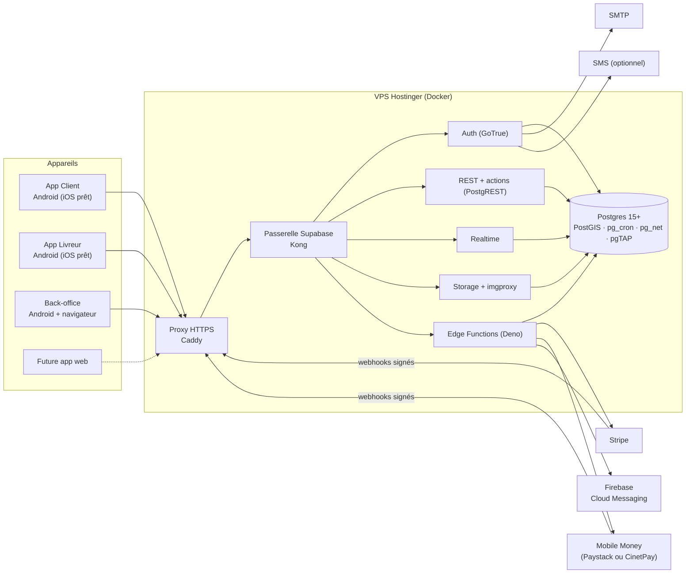

# Architecture

> Phase 3 (rôle : Mobile Architect). Décisions : `DECISION_LOG.md` (ADR-001 à ADR-011). Conception détaillée des flux :
> `docs/system-design.md`. Base de données : `docs/data-model.md`. Design : `docs/design/design-system.md`.

## 1. Vue d'ensemble



**Principe directeur** : les apps affichent et demandent ; **le serveur décide** (statuts, montants, attribution, droits).
Toutes les règles de l'INTAKE §7.C vivent dans Postgres (ADR-003) et sont donc identiques pour le mobile et le web (ADR-010).

## 2. Dépôt (monorepo, workspace Dart)

```
food-delive/
├── apps/
│   ├── client/          # app Client (Android, iOS)
│   ├── courier/         # app Livreur (Android, iOS)
│   └── backoffice/      # Restaurant + Admin (Android, web)
├── packages/
│   └── core/            # code partagé par les 3 apps
├── supabase/
│   ├── config.toml      # pile locale (supabase start)
│   ├── migrations/      # schéma, RLS, fonctions métier, tâches planifiées
│   ├── functions/       # Edge Functions (TypeScript / Deno)
│   ├── tests/           # pgTAP : RLS, machine à états, attribution, montants
│   └── seed.sql         # données de développement
├── infra/               # VPS : compose (surcharges), Caddyfile, sauvegardes, déploiement
├── docs/                # produit, design, architecture, API, exploitation
└── .github/workflows/   # CI / CD
```

Le workspace Dart (`pubspec.yaml` racine, `workspace:`) résout une seule fois les dépendances des 4 paquets.

## 3. Couches Flutter (feature-first, sans sur-structure)

```
packages/core/lib/
├── config/        # Env (lu via --dart-define), constantes
├── supabase/      # initialisation (session en stockage sécurisé), traduction des erreurs → Failure
├── design/        # jetons, ThemeData clair/sombre, composants partagés
├── l10n/          # textes français (ARB) générés
├── models/        # entités freezed : Order, OrderStatus, Address, Restaurant, Product, Transaction…
├── data/          # repositories partagés (auth, profil, adresses, commandes, temps réel)
├── auth/          # écrans et contrôleurs communs S-01 à S-06
└── utils/         # monnaie, téléphone, distance / ETA, dates

apps/<app>/lib/
├── main.dart      # bootstrap : Env, Supabase, Firebase, ProviderScope
├── router.dart    # go_router + gardes (session, rôle, profil complet)
└── features/<feature>/
    ├── data/          # repository propre à la feature (si non partagé)
    ├── application/   # Notifier / AsyncNotifier Riverpod (logique d'écran)
    └── presentation/  # écrans et widgets (aucune logique métier)
```

| Couche | Contient | Interdit |
|--------|----------|----------|
| presentation | widgets, lecture de providers, navigation | appels Supabase, calculs métier |
| application | Notifiers Riverpod, orchestration, états `AsyncValue` | widgets, détails SQL |
| data | repositories : appels REST / actions / Realtime / Storage, conversion JSON ↔ modèles | logique d'écran |
| models | entités immuables (freezed), énumérations, règles pures (ex. libellé d'un statut) | dépendance à Flutter ou Supabase |

Repositories **concrets** (pas d'interface abstraite tant qu'une seule implémentation existe — YAGNI) ; ils reçoivent le
`SupabaseClient` par provider et sont remplacés par des doublures (`mocktail`) dans les tests.

## 4. Gestion d'état (Riverpod 3, génération de code)

- `@riverpod` partout ; `AsyncValue` pour tout chargement (états chargement / données / erreur).
- Providers `autoDispose` par défaut (libèrent les abonnements Realtime) ; `keepAlive` seulement pour session, profil, panier.
- Reconstructions ciblées avec `select` ; actions optimistes (panier, quantités) avec retour arrière en cas d'erreur.
- Détails : `docs/system-design.md`.

## 5. Navigation (go_router)

- Une table de routes par app ; redirection centralisée : pas de session → bienvenue ; profil incomplet → S-06 ;
  rôle manquant (livreur, restaurant, admin) → écran adapté (AUTH-09).
- Shell avec barre basse (`StatefulShellRoute`) conservant l'état de chaque onglet.
- Liens profonds depuis les notifications : `/orders/:id` (client), `/missions/:id` (livreur), `/orders/:id` (restaurant).
- Les gardes ne sont qu'un confort : l'accès réel est contrôlé par la RLS.

## 6. Configuration, environnements, secrets

| Environnement | API | Usage |
|---------------|-----|-------|
| `local` | Supabase local (Docker) — `http://10.0.2.2:54321` depuis l'émulateur Android | Développement, tests |
| `prod` | `https://api.<domaine>` (VPS) | Production |

- Les apps reçoivent leur configuration par `--dart-define-from-file=env/<env>.json` (fichiers ignorés par git ;
  `env/example.json` versionné) : `SUPABASE_URL`, `SUPABASE_ANON_KEY`, `STRIPE_PUBLISHABLE_KEY`. Ce sont des clés
  **publiques** par conception ; la sécurité repose sur la RLS.
- Clés Google Maps : injectées au build (propriété Gradle / `local.properties`, hors dépôt) et **restreintes** au paquet + empreinte.
- **Aucun secret dans les apps** : clé `service_role`, clés secrètes Stripe / Mobile Money, compte de service Firebase,
  identifiants SMTP / SMS restent dans le `.env` du VPS et les secrets des Edge Functions.
- Session : stockage sécurisé (`flutter_secure_storage` → Android Keystore / iOS Keychain) branché sur `supabase_flutter`.

## 7. Capacités natives et plugins

| Besoin | Plugin | Permission | Quand elle est demandée |
|--------|--------|------------|--------------------------|
| Backend | `supabase_flutter` | — | — |
| État / navigation / modèles | `flutter_riverpod`, `riverpod_annotation`, `go_router`, `freezed`, `json_serializable` | — | — |
| Session sécurisée | `flutter_secure_storage` | — | — |
| Cartes | `google_maps_flutter` | — | — |
| Position | `geolocator` | Localisation « pendant l'utilisation » ; livreur : service au premier plan de type localisation | Client : ajout d'une adresse · Livreur : passage en ligne |
| Photos | `image_picker` (réduction à 800 px) | Caméra (seulement si « Prendre une photo ») | Profil livreur, produits |
| Notifications | `firebase_messaging`, `flutter_local_notifications` (canaux et sons) | Notifications (Android 13+) | Après la 1ʳᵉ commande · passage en ligne · 1ʳᵉ connexion restaurant |
| Paiement carte | `flutter_stripe` (feuille de paiement native) | — | — |
| Appels, itinéraire | `url_launcher` (`tel:`, Google Maps / Waze) | — | — |
| Partage du code / reçu | `share_plus` | — | — |
| Images réseau | `cached_network_image` | — | — |
| Cache local léger | `shared_preferences` | — | — |
| Numéros | `phone_numbers_parser` (pur Dart) | — | — |
| Alerte sonore restaurant | `audioplayers` (Android + web) | — | — |

App Client : **aucune** localisation en arrière-plan. App Livreur : localisation uniquement quand le livreur est en ligne,
avec notification permanente (déclaration Play Console du service au premier plan).

## 8. Hébergement (VPS) et livraison continue

- **Pile** : Supabase auto-hébergé (`docker compose`, images aux versions figées) + **Caddy** (HTTPS automatique)
  devant Kong. Ports publics : 80 / 443 (et 22 pour SSH par clé). Postgres et Studio non exposés ; Studio par tunnel SSH.
- **Domaines** : `api.<domaine>` → API Supabase. La future app web aura son propre sous-domaine, ajouté aux origines CORS.
- **Sauvegardes** : `pg_dump` quotidien + archive des fichiers Storage, chiffrés, copiés hors du VPS, rétention 14 jours ;
  restauration testée en phase 5 et documentée (`docs/operations.md`).
- **CI (chaque push / PR)** : `dart analyze` et `flutter test` (4 paquets) · pile Supabase dans le runner → migrations
  rejouées depuis zéro + `supabase test db` (pgTAP) · tests des Edge Functions (Deno) · build APK de contrôle.
- **CD (push sur `main`)** : sauvegarde → migrations appliquées par tunnel SSH → synchronisation des Edge Functions +
  redémarrage du service → vérification de santé ; échec = arrêt et procédure de retour arrière.
- **Stores** : Fastlane (phase 6) — AAB signés, piste de test interne Google Play.

## 9. Sécurité (résumé — détails dans `docs/data-model.md` et la revue de phase 5)

RLS sur toutes les tables · écritures sensibles uniquement via fonctions SQL qui vérifient l'acteur et l'état ·
webhooks de paiement signés et vérifiés auprès du fournisseur · limitation des tentatives (connexion, codes OTP, code de
livraison) · stockage sécurisé des jetons · photos des livreurs dans un espace privé · données personnelles minimales,
anonymisées à la suppression du compte · journal d'audit des actions admin · VPS durci.

## 10. Performance (cibles : `docs/design/direction.md` §5)

Impeller · listes paresseuses et `const` · vignettes WebP servies à la bonne taille par imgproxy · pagination
(20 éléments) et colonnes utiles uniquement · cache local affiché immédiatement · préchargement du menu au toucher ·
Realtime limité aux écrans ouverts · police embarquée · APK par architecture. Mesures DevTools en phase 5 (`docs/performance.md`).
