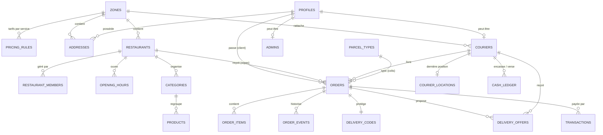

# Modèle de données, règles d'accès et API métier

> Phase 3 (rôle : Database Architect). Postgres (Supabase auto-hébergé) + PostGIS. Implémenté par migrations
> (`supabase/migrations/`), testé par pgTAP (`supabase/tests/`). Ce document est aussi la **base du contrat d'API**
> pour la future app web (`docs/api/` le détaillera action par action).

## 1. Principes

- Clés `uuid`, montants en **entiers** dans l'unité de la devise (XOF n'a pas de décimales), dates `timestamptz` (UTC),
  positions `geography(Point, 4326)`, énumérations Postgres pour les états.
- **RLS activée sur toutes les tables.** Lecture par politiques ; **écritures sensibles uniquement via des fonctions**
  (`SECURITY DEFINER`, `search_path` fixé) qui vérifient l'acteur, l'état et les montants. Aucune table métier
  n'accepte d'`UPDATE` direct de statut ou de montant depuis une app.
- Données copiées (« figées ») sur la commande au moment où elles comptent : prix, adresses, informations du livreur.
- Schéma `public` : tables et actions exposées par l'API. Schéma `private` : fonctions internes (aides RLS, attribution,
  tâches planifiées), non exposé.

## 2. Diagramme entité-association (principal)

## 3. Énumérations

| Type | Valeurs |
|------|---------|
| `order_type` | `food`, `parcel` |
| `order_status` | `awaiting_payment`, `pending`, `accepted`, `preparing`, `ready`, `searching_courier`, `courier_assigned`, `picked_up`, `in_transit`, `delivered`, `rejected`, `cancelled`, `failed` |
| `payment_method` | `cash`, `mobile_money`, `card` |
| `order_payment_status` | `unpaid`, `paid`, `refund_pending`, `refunded` |
| `transaction_status` | `pending`, `succeeded`, `failed`, `cancelled`, `refunded` |
| `courier_status` | `pending`, `approved`, `rejected`, `suspended` |
| `vehicle_type` | `motorbike`, `bicycle`, `car`, `on_foot` |
| `offer_status` | `pending`, `accepted`, `declined`, `expired`, `cancelled` |
| `actor_role` | `customer`, `restaurant`, `courier`, `admin`, `system` |
| `cash_entry_type` | `collected`, `remitted` |

Statuts autorisés par type (contrainte `check`) — repas : `awaiting_payment, pending, accepted, preparing, ready,
picked_up, in_transit, delivered, rejected, cancelled, failed` ; colis : `awaiting_payment, searching_courier,
courier_assigned, picked_up, in_transit, delivered, cancelled, failed`. Pour un repas, l'affectation du livreur
(`courier_id`) est indépendante du statut et apparaît dans la chronologie (« Livreur assigné »).

## 4. Dictionnaire des tables

### Référentiel et paramètres

| Table | Colonnes principales | Notes |
|-------|----------------------|-------|
| `zones` | `id`, `name`, `city`, `country_code` (`CI`), `currency` (`XOF`), `timezone` (`Africa/Abidjan`), `center`, `radius_m`, `is_active` | Une adresse appartient à la zone active qui la contient (la plus proche si chevauchement) |
| `pricing_rules` | PK (`zone_id`, `service`) ; `base_fee`, `per_km_fee`, `min_fee`, `max_fee`, `detour_factor` (1,30), `rounding_step` (25), `courier_base`, `courier_per_km` | Frais = arrondi supérieur au pas de (base + prix/km × km × détour), borné [plancher, plafond] |
| `settings` | ligne unique : `offer_timeout_s` (45), `restaurant_timeout_s` (600), `payment_timeout_s` (900), `dispatch_alert_s` (600), `dispatch_cancel_s` (1800), `location_fresh_s` (120), `support_phone` ; `delivery_code_max_attempts` (5) ajouté à l'Inc-8 | Modifiables par l'admin (ADM-05), chaque modification tracée dans `audit_log` |
| `payment_options` | `country_code`, `method`, `operator` (`orange`, `mtn`, `wave`, `moov`…), `provider` (`stripe`, `paystack`, `cinetpay`, `cash`), `label`, `is_enabled`, `position` | Seules les lignes activées sont proposées (PAY-01) |
| `parcel_types` | `id`, `code`, `label`, `max_weight_kg`, `allowed_vehicles vehicle_type[]`, `position`, `is_active` | Données initiales : Documents · Petit colis ≤ 5 kg · Colis moyen ≤ 15 kg |

### Comptes

| Table | Colonnes principales | Notes |
|-------|----------------------|-------|
| `profiles` | PK `id` = `auth.users.id` ; `first_name`, `last_name`, `phone` (E.164), `city`, `is_suspended`, `suspension_reason`, `deleted_at` | Créé par déclencheur à l'inscription ; anonymisé à la suppression (AUTH-08) |
| `admins` | PK `user_id` | Capacité admin (le 1ᵉʳ admin par script) |
| `addresses` | `id`, `user_id`, `zone_id`, `city`, `label`, `district`, `landmark`, `instructions`, `location`, `is_default` | Déclencheur : calcule zone et ville, refuse hors zone ; index unique partiel « une seule adresse par défaut » |
| `couriers` | PK `user_id` ; `zone_id`, `vehicle_type`, `plate_number`, `photo_path`, `status`, `status_reason`, `approved_at`, `is_online`, `online_since` | `check` : immatriculation obligatoire si moto ou voiture |
| `courier_locations` | PK `courier_id` ; `latitude`, `longitude`, `location` (calculée), `accuracy_m`, `recorded_at` | Une ligne par livreur en ligne (dernière position, effacée hors ligne), index spatial |
| `push_tokens` | PK `token` ; `user_id`, `app` (`client`, `courier`, `backoffice`), `platform`, `updated_at` | |

### Restaurants et catalogue

| Table | Colonnes principales | Notes |
|-------|----------------------|-------|
| `restaurants` | `id`, `zone_id`, `name`, `description`, `cover_path`, `phone`, `location`, `district`, `landmark`, `commission_rate` (%, 2 déc.), `prep_time_min`, `is_active`, `is_temporarily_closed` | Commission, zone et activation modifiables par l'admin seulement |
| `restaurant_members` | `id`, `restaurant_id`, `user_id` (nul tant que non relié), `login_email`, `login_phone` | Invitation par identifiant ; reliée automatiquement à la vérification du compte correspondant |
| `opening_hours` | `restaurant_id`, `weekday` (0–6), `opens_at`, `closes_at` | Plusieurs plages par jour ; heure locale de la zone |
| `categories` | `id`, `restaurant_id`, `name`, `position` | Ordre d'affichage du menu |
| `products` | `id`, `restaurant_id`, `category_id`, `name`, `description`, `price` (> 0), `photo_path`, `is_available`, `archived_at` | Archivé au lieu d'être supprimé s'il a été commandé |

### Commandes et livraison

| Table | Colonnes principales | Notes |
|-------|----------------------|-------|
| `orders` | `id`, `number` (« R-48K2Q » / « C-7K2P9 », unique), `type`, `status`, `customer_id`, `zone_id`, `currency`, `restaurant_id` (repas), `parcel_type_id`, `parcel_description` (colis), `courier_id`, `courier_info` (jsonb figé : prénom, téléphone, moyen, immatriculation, photo) | `idempotency_key` unique par client (anti double commande) |
| | **Retrait** figé : `pickup_location`, `pickup_name`, `pickup_phone`, `pickup_district`, `pickup_landmark`, `pickup_instructions` | Repas : le restaurant ; colis : l'expéditeur |
| | **Destination** figée : `dropoff_location`, `recipient_name`, `recipient_phone`, `dropoff_district`, `dropoff_landmark`, `dropoff_instructions` | Repas : le client |
| | **Montants** figés : `subtotal`, `delivery_fee`, `total`, `commission_amount`, `courier_earning`, `platform_amount`, `distance_m` | `check` : `total = subtotal + delivery_fee` ; `platform_amount = delivery_fee − courier_earning + commission_amount` |
| | **Paiement** : `payment_method`, `payment_status` | `payment_status` écrit uniquement par les fonctions de paiement |
| | **Dates** : `created_at`, `paid_at`, `accepted_at`, `ready_at`, `assigned_at`, `picked_up_at`, `delivered_at`, `closed_at`, `dispatch_started_at`, `dispatch_alerted_at` ; `close_reason` | |
| `order_items` | `id`, `order_id`, `product_id`, `name`, `unit_price`, `quantity` (> 0), `line_total` | Copie du produit au moment de la commande |
| `order_events` | `id`, `order_id`, `kind` (`status_changed`, `courier_assigned`, `courier_released`, `problem_reported`, `code_failed`, `code_locked`, `payment_*`, `dispatch_alert`…), `status`, `actor_id`, `actor_role`, `reason`, `created_at` | Chronologie (TRK-03) ; source des notifications |
| `delivery_codes` | PK `order_id` ; `code` (4 chiffres), `failed_attempts`, `locked_at` | Lisible **uniquement** par le client de la commande |
| `delivery_offers` | `id`, `order_id`, `courier_id`, `status`, `expires_at`, `responded_at`, `summary` (jsonb : type, quartiers et repères, distances, gain, montant à encaisser) | Index uniques partiels : une offre en attente par livreur et par commande |

### Paiements

| Table | Colonnes principales | Notes |
|-------|----------------------|-------|
| `transactions` | `id`, `order_id`, `amount`, `currency`, `method`, `operator`, `provider`, `provider_reference` (unique), `status`, `failure_reason`, `refund_reference`, `created_at`, `succeeded_at`, `updated_at` | Index unique partiel : au plus **une** transaction `pending`, `succeeded` ou `refunded` par commande (PAY-05) ; `check` : `amount` = total de la commande (vérifié par la fonction) |
| `cash_ledger` | `id`, `courier_id`, `order_id`, `type` (`collected` / `remitted`), `amount`, `reference`, `recorded_by`, `created_at` | Solde dû par livreur = Σ encaissé − Σ versé (vue `courier_cash_balances`) |
| `audit_log` | `id`, `actor_id`, `action`, `target_type`, `target_id`, `details` (jsonb), `created_at` | Actions admin hors commandes (suspension, identifiant, paramètres) |

## 5. Machine à états — qui peut faire quoi (fonction `transition_order`)

| De → vers | Acteur | Conditions / effets |
|-----------|--------|---------------------|
| `awaiting_payment` → `pending` (repas) / `searching_courier` (colis) | système | Paiement confirmé par webhook vérifié |
| `awaiting_payment` → `cancelled` | client, système | Abandon ou expiration (15 min) ; transaction en attente annulée |
| `pending` → `accepted` | restaurant | |
| `pending` → `rejected` | restaurant (motif), système (10 min) | Remboursement si payé |
| `pending` → `cancelled` | client, admin | Remboursement si payé |
| `accepted` → `preparing` | restaurant | Démarre la recherche de livreur |
| `preparing` → `ready` | restaurant | Notifie le livreur assigné |
| `ready` → `picked_up` | livreur assigné, restaurant (« remise ») | Exige un livreur assigné |
| `searching_courier` → `courier_assigned` | livreur (offre acceptée), admin | |
| `courier_assigned` → `searching_courier` | livreur (abandon, motif), admin | Relance la recherche |
| `courier_assigned` → `picked_up` | livreur assigné | Colis en espèces : encaissement confirmé d'abord |
| `picked_up` → `in_transit` | livreur assigné | |
| `in_transit` → `delivered` | livreur (code valide), admin (motif) | Repas en espèces : encaissement demandé ensuite |
| `picked_up` / `in_transit` → `failed` | livreur (motif), admin | Admin décide du remboursement |
| `accepted` / `preparing` / `ready` → `cancelled` | admin (motif), système (30 min sans livreur) | Remboursement si payé ; offres annulées |
| `searching_courier` / `courier_assigned` → `cancelled` | client, admin, système | Idem |

Toute autre transition est refusée (`invalid_transition`). Chaque transition écrit un `order_events` dans la même transaction SQL.

## 6. Règles d'accès (RLS)

S = lecture · I = insertion · U = modification · D = suppression · « fn » = uniquement via fonction.

| Table | Client | Livreur | Restaurant (membre) | Admin |
|-------|--------|---------|---------------------|-------|
| `zones`, `parcel_types`, `payment_options`, `settings` | S | S | S | S I U |
| `pricing_rules` | — (devis par fonction) | — | — | S I U |
| `profiles` | S U (soi) | S U (soi) | S U (soi) | S, U fn |
| `addresses` | S I U D (siennes) | — | — | S |
| `couriers` | — | S (soi), I U fn | — | S, U fn |
| `courier_locations` | S (livreur de sa commande active) | S (soi), U fn | — | S |
| `restaurants`, `opening_hours`, `categories`, `products` | S (actifs) | — | S I U D (le sien ; commission, zone, activation exclues) | S I U D |
| `restaurant_members` | — | — | S (soi) | S I D |
| `orders` | S (siennes) | S (assignées) | S (les siennes, hors `awaiting_payment`) | S |
| `order_items`, `order_events` | S (ses commandes) | S (missions assignées) | S (ses commandes) | S |
| `delivery_codes` | S (ses commandes) | — | — | S |
| `delivery_offers` | — | S (siennes) | — | S |
| `transactions` | S (ses commandes) | — | — | S, U fn |
| `cash_ledger` | — | S (siennes) | — | S, I fn |
| `push_tokens` | S I U D (siens) | idem | idem | — |
| `audit_log` | — | — | — | S |

Aides RLS (`private`, `STABLE`, `SECURITY DEFINER`) : `is_admin()`, `is_member_of(restaurant_id)`,
`courier_status()`. Un compte suspendu (`profiles.is_suspended`) est refusé par toutes les fonctions d'écriture.

**Storage** : bucket `media` (lecture publique : couvertures et photos produits, chemin `restaurants/<id>/…`, écriture par
les membres du restaurant et l'admin) ; bucket `couriers` (privé : photo lisible par le livreur, l'admin et le client
d'une commande active avec ce livreur). Vignettes servies par le service d'images (largeur demandée, WebP).

## 7. API métier (actions `/rest/v1/rpc/<nom>`)

Erreurs : exception Postgres avec un **code stable** dans le message (ex. `restaurant_closed`) et un détail JSON ;
les apps et le web traduisent ces codes en messages (plan §3.4).

| Action | Acteur | Rôle |
|--------|--------|------|
| `my_roles()` | tous | Rôles du compte (admin, restaurants, statut livreur) pour l'aiguillage des apps |
| `quote_food_order(restaurant_id, address_id, items)` | client | Devis serveur : sous-total, frais, total, distance, livreurs disponibles, écarts éventuels |
| `place_food_order(restaurant_id, address_id, items, payment_method, operator, expected_total, idempotency_key)` | client | Crée la commande après revérification ; `price_changed` si le total diffère |
| `quote_parcel(pickup, dropoff, parcel_type_id)` | client | Devis colis |
| `place_parcel_order(pickup, dropoff, recipient, parcel_type_id, description, instructions, payment_method, operator, expected_total, idempotency_key)` | client | Crée la demande |
| `cancel_order(order_id, reason)` | client, admin | Selon §5 ; déclenche le remboursement si payé |
| `transition_order(order_id, to_status, reason)` | restaurant, livreur, admin | Machine à états (§5) |
| `submit_courier_profile(zone_id, vehicle_type, plate_number, photo_path)` | livreur | Crée / met à jour le profil et le passe `pending` |
| `set_courier_online(online)` | livreur | Refusé si non approuvé, ou hors ligne pendant une mission |
| `report_location(lat, lng, accuracy_m, heading, speed_mps, recorded_at)` | livreur | Met à jour la dernière position (si en ligne) |
| `respond_to_offer(offer_id, accept)` | livreur | Accepte (verrouillage, une mission à la fois) ou refuse |
| `release_mission(order_id, reason)` | livreur | Abandon avant récupération → nouvelle recherche |
| `confirm_delivery(order_id, code)` | livreur | Vérifie le code (essais limités) → `delivered` |
| `confirm_cash_collected(order_id)` | livreur | Transaction espèces réussie + écriture `cash_ledger` |
| `report_problem(order_id, kind, comment)` | livreur | Événement + alerte admin |
| `admin_set_courier_status(user_id, status, reason)` | admin | Valider, refuser, suspendre |
| `admin_assign_courier(order_id, courier_id, reason)` | admin | Attribution / réattribution manuelle |
| `admin_confirm_delivery(order_id, reason)` | admin | Livraison sans code (tracée) |
| `admin_set_user_suspended(user_id, suspended, reason)` | admin | |
| `admin_record_cash_remittance(courier_id, amount, reference)` | admin | Versement d'espèces |
| `admin_mark_refunded(transaction_id, reference)` | admin | Remboursement effectué hors application |
| `admin_stats(from, to)` | admin | Indicateurs du tableau de bord |

**Edge Functions** (`/functions/v1/…`) : `payments-create` (crée le paiement Stripe ou Mobile Money d'une commande),
`payments-webhook-stripe`, `payments-webhook-momo` (signature vérifiée, idempotent), `payments-refund` (appel interne),
`push` (appel interne depuis la base), `account-delete` (anonymisation + suppression du compte d'authentification),
`admin-update-login` (changement d'identifiant de connexion par l'admin).

## 8. Automatismes

- **Déclencheurs** : création du profil à l'inscription ; liaison des invitations restaurant à la vérification du compte ;
  zone et ville des adresses ; `updated_at` ; écriture de la chronologie ; appel de la fonction `push` à chaque
  événement notifiable (via `pg_net`, secret partagé dans le coffre `vault`).
- **Tâche planifiée unique** `private.tick()` (`pg_cron`, toutes les 10 s) : expiration des offres → livreur suivant ;
  démarrage des recherches en attente ; alerte à 10 min et annulation à 30 min sans livreur ; refus automatique après
  10 min sans réponse du restaurant ; annulation des paiements non confirmés après 15 min.
- **Attribution** (`private.dispatch(order_id)`) : livreurs `approved`, en ligne, position < `location_fresh_s`, même zone,
  sans mission ni offre en attente, triés par distance au retrait ; verrouillage `FOR UPDATE SKIP LOCKED` pour éviter les doubles attributions.

## 9. Temps réel

Publication Realtime limitée à : `orders`, `order_events`, `delivery_offers`, `courier_locations`, `couriers`.
Les abonnés ne reçoivent que les lignes autorisées par la RLS.

## 10. Index

`orders (customer_id, created_at desc)` · `orders (restaurant_id, status)` · `orders (courier_id) where status actif` ·
`orders (status) where status actif` · `order_events (order_id, created_at)` · `order_items (order_id)` ·
`transactions (order_id)` · `delivery_offers (courier_id) where pending` · `addresses (user_id)` ·
`products (restaurant_id, category_id)` · `restaurants (zone_id)` · index spatiaux sur `restaurants.location`,
`courier_locations.location`, `zones.center`.

## 11. Données personnelles

Collecte minimale (identité, téléphone, email, adresses, position des livreurs en ligne). Suppression de compte :
nom, téléphone, email, adresses et photo effacés ou anonymisés ; commandes et transactions conservées sans donnée
identifiante (obligations comptables). Positions des livreurs : seule la dernière est conservée.
Durées de conservation à confirmer avec vos textes juridiques (tâche manuelle n° 10).
