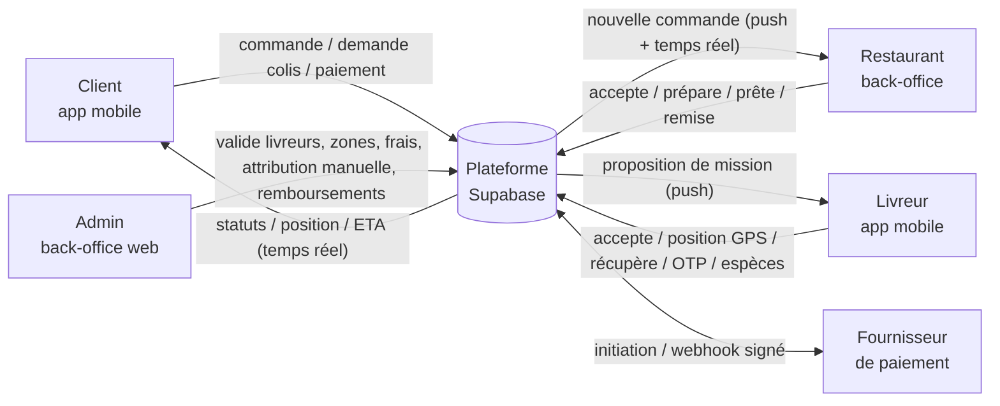
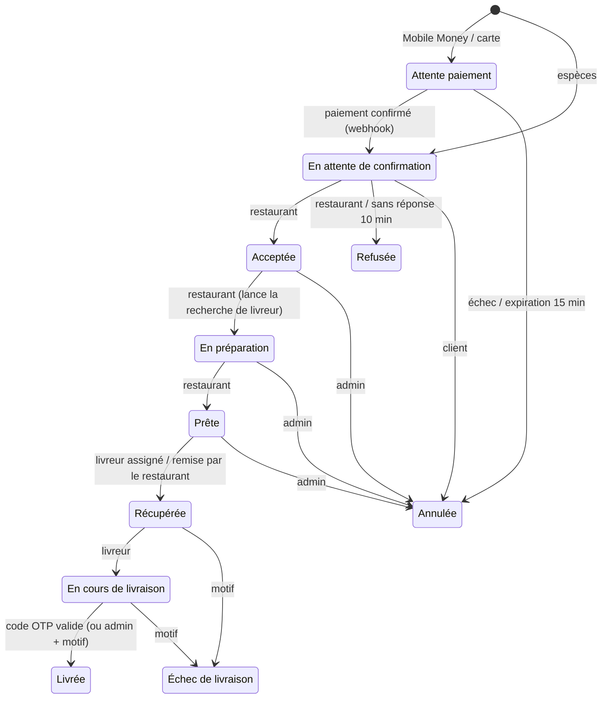
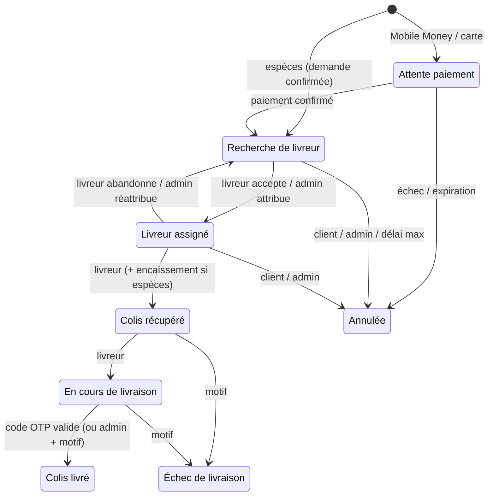
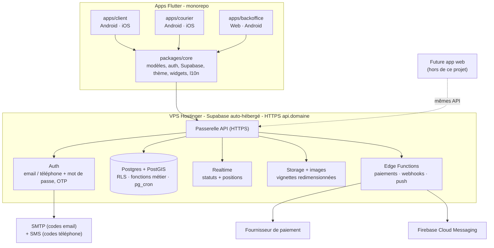

# Plan de réalisation — MVP Livraison (repas + colis)

> **Statut** : ✅ **validé le 2026-10-18** · **Version** : v2 (intègre vos précisions et réponses du 2026-10-18) · **Mode** : PLAN_PUIS_VALIDATION
> Source : `INTAKE.md` + vos précisions. Hypothèses = `H-xx` · Décisions = `DECISION_LOG.md` · Tâches manuelles = `docs/manual-tasks.md`
> · Design = `docs/design/direction.md`.

---

## 0. Décisions et questions

### Décidé avec vous (2026-10-18)

| ID | Décision | Conséquence dans le plan |
|----|----------|--------------------------|
| D-1 | Design **très moderne, fluide, rapide**, inspiré de vos 5 références | `docs/design/direction.md` : jetons, composants, budgets de performance mesurés ; maquette interactive à valider avant le code des écrans |
| D-2 | Le back-end doit **exposer des API** réutilisables par une future application web | Toutes les règles sont dans la base : la même API (REST, temps réel, auth, fichiers, fonctions) sert le mobile et le web, avec la même sécurité. Contrat documenté (§6.1) |
| D-3 | Connexion **email + mot de passe** (code OTP reçu par email) en plus du **téléphone + mot de passe** (code OTP par SMS) | Remplace l'ancienne Q3. Seules les méthodes réellement configurées sont affichées (pas de SMS configuré → email seul) |
| D-4 | **Tout est hébergé sur votre VPS Hostinger** (Supabase auto-hébergé, base de données, fonctions) | Déploiement automatisé par la CI vers le VPS, HTTPS, sauvegardes, supervision (§6.2). Plus d'abonnement Supabase |
| D-5 | Lancement en **Côte d'Ivoire (Abidjan, XOF, +225)** ; **cartes via Stripe** (vous disposez d'une société dans un pays compatible) | Stripe : paiement par carte en XOF (devise sans décimales), règlement dans la devise de votre société. Mobile Money par un second fournisseur (voir ci-dessous) |
| D-6 | **Android d'abord** (Q4 = A) | Code compatible iOS, publication iOS plus tard |
| D-7 | **Espace restaurant et dashboard admin dans ce projet** (Q5 = A) | Espaces de l'app unique (D-8) |
| D-8 | **Une seule app mobile, un espace par rôle** (Client, Livreur, Restaurant, Admin) — décidé le 2026-10-18 | Remplace les 3 apps séparées (ADR-016) ; `apps/mobile` |

**Reste à préciser avant l'Inc-11 (non bloquant)** : le fournisseur **Mobile Money** — **Paystack** si votre société peut
y ouvrir un compte marchand pour la Côte d'Ivoire, sinon **CinetPay**. L'intégration est conçue pour l'un ou l'autre.
À vérifier aussi avec votre conseil : les obligations (fiscales, réglementaires) liées à l'encaissement par une société
étrangère pour une activité en Côte d'Ivoire.

### Questions posées (réponses ci-dessus, conservées pour mémoire)

Seules les décisions à impact **métier / financier / légal / irréversible** sont posées. Sans réponse,
l'option **recommandée** (défaut) s'applique.

### Q1 — Pays et ville de lancement
- **Impact** : devise, indicatif téléphonique par défaut, opérateurs Mobile Money, fournisseur de paiement, zones initiales.
- **Recommandé (défaut)** : **Côte d'Ivoire — Abidjan**, devise **XOF**, indicatif **+225** (cohérent avec l'exemple de l'INTAKE).
- Le modèle de données reste multi-pays (zone → pays → devise) ; une seule ville au MVP (« livraison entre plusieurs villes » exclue).

### Q2 — Fournisseur de paiement (Mobile Money + carte)
- **Constat** : Stripe n'ouvre pas de compte marchand direct en Côte d'Ivoire ; ce pays est servi via **Paystack**
  (filiale de Stripe). La règle de l'INTAKE « Stripe uniquement dans les pays compatibles » exclut donc Stripe en CI.
- **A — Recommandé (défaut)** : **Paystack** pour Mobile Money (Orange, MTN, Wave ; Moov non confirmé) **et** cartes.
  Une seule intégration, webhooks signés, clés de test pour valider le parcours. Frais Mobile Money annoncés : 1,95 %/transaction.
  Le code reste multi-fournisseurs : Stripe direct activable plus tard pour un pays compatible.
- **B** : **CinetPay** (acteur ivoirien : Orange, MTN, Moov, Wave + cartes) pour Mobile Money ; Stripe codé mais désactivé en CI.
- **C** : vous avez une entité dans un pays compatible Stripe → Stripe pour les cartes + Paystack ou CinetPay pour Mobile Money.
- Dans tous les cas : **compte marchand + vérification (KYC) à démarrer tôt** (délais possibles de plusieurs semaines).

### ~~Q3 — Mode de connexion~~ → tranchée (D-3)
- **Email + mot de passe** : vérification de l'email et récupération du mot de passe par **code à 6 chiffres reçu par email**
  (serveur d'envoi d'emails SMTP à configurer, ex. la messagerie Hostinger).
- **Téléphone + mot de passe** : vérification du numéro et récupération par **code SMS** (Twilio Verify, ou une passerelle
  SMS locale branchée par un « hook » d'envoi). Tant qu'aucun fournisseur SMS n'est configuré, l'option n'est pas proposée.
- Le numéro de téléphone est demandé dans le profil dans les deux cas (indispensable pour joindre le client à la livraison).
- Session longue durée, jetons dans le stockage sécurisé du téléphone. En développement : codes de test, **aucun coût**.

### Q4 — Plateformes publiées au MVP
- **A — Recommandé (défaut)** : **Android d'abord** (apps Client, Livreur, Restaurant) + back-office **web**.
  Le code reste compatible iOS ; publication iOS après validation du marché.
- **B** : Android **et** iOS dès le MVP → compte Apple Developer (99 $/an) et builds iOS via une machine macOS
  (runner macOS en CI, car votre poste est sous Windows).

### Q5 — Espace restaurant et dashboard admin (« on se concentre uniquement sur le mobile »)
- **Constat** : sans espace restaurant ni admin, le MVP n'est pas exploitable (personne ne valide les livreurs,
  ne crée les restaurants ni ne règle les frais).
- **A — Recommandé (défaut)** : les construire **dans ce projet**, en Flutter : une app « Back-office » pensée mobile et
  tablette (Android) pour les restaurants, et utilisable aussi dans un navigateur pour l'admin (même code, aucun effort de plus).
  La future application web s'appuiera sur les mêmes API.
- **B** : reporter les deux à la future application web → le MVP mobile ne pourra être exploité qu'une fois cette app web livrée.

### Informations à fournir (non bloquant pour démarrer)
- **VPS** : offre Hostinger (RAM / CPU / disque — 8 Go de RAM recommandés pour Supabase), système, localisation du
  centre de données (Europe la plus proche de l'Afrique de l'Ouest conseillée pour la rapidité).
- **Nom de domaine** pour l'API (ex. `api.mondomaine.com`).
- **Nom de l'app, logo et éventuelles photos de marque** (sinon nom de travail).

---

## 1. Compréhension du besoin

**Objectif** : un MVP **réellement utilisable** (données persistantes, états cohérents, aucune fonction critique simulée)
permettant de commander un repas ou d'envoyer un colis, de payer, de suivre la livraison et de la recevoir.

**Acteurs** : Client · Livreur · Restaurant (espace simplifié) · Administrateur.

**Périmètre — 4 modules uniquement**
1. Comptes et adresses (inscription OTP, profils, adresses sans nom de rue, profils livreurs validés par l'admin).
2. Commande de repas (restaurants de la zone, panier mono-restaurant, gestion par le restaurant) et livraison de colis (estimation, confirmation).
3. Livraison : attribution des livreurs, mission, suivi temps réel, statuts, confirmation par OTP, notifications.
4. Paiements : Mobile Money, carte (selon Q2), espèces ; transactions, historique, reçus, frais et commissions, rapprochement des espèces.

**Hors périmètre** (INTAKE §9, non développé) : médicaments, express, fidélité, parrainage, premium, publicités,
portefeuille interne, messagerie avancée, IA, international, inter-villes, commandes groupées, multi-destinations,
promotions, analytique avancée, stocks avancés, réservation.

**Contraintes** : Android modeste et données mobiles limitées · connexion intermittente · numéros internationaux ·
devise locale · interface en français, simple, rassurante · sécurité serveur (RLS) · publication sur les stores ·
**design très moderne, fluidité et rapidité mesurées** · **API réutilisable par une future app web** ·
**hébergement complet sur le VPS Hostinger**.

---

## 2. Hypothèses (comblent les vides de l'INTAKE — contestables)

| ID | Hypothèse |
|----|-----------|
| H-01 | Un compte = un email **ou** un numéro (identifiant de connexion) + mot de passe ; le téléphone figure toujours au profil. Un même utilisateur peut être client **et** livreur. Comptes restaurant et admin créés par un admin (le premier admin via un script fourni). |
| H-02 | Zone desservie = ville + centre + rayon (km), gérée par l'admin. Une adresse hors zone est refusée avec un message clair. |
| H-03 | Distance de référence = distance à vol d'oiseau × coefficient de détour (défaut 1,3), calculée côté serveur (PostGIS). Aucune API de calcul d'itinéraire payante. |
| H-04 | Frais de livraison = base + prix/km, avec plancher et plafond, arrondis au pas supérieur (25 F, payable en espèces), par zone et par service (repas / colis). Rémunération livreur = fixe + /km. Commission restaurant = % du sous-total, par restaurant. Tous configurables par l'admin ; valeurs initiales indicatives. |
| H-05 | Montants **calculés côté serveur** et **figés** sur la commande : sous-total, frais, total, commission, rémunération livreur, marge plateforme. |
| H-06 | Le payeur est toujours le client. Espèces : encaissées **à la livraison** pour un repas, **à la récupération** (auprès de l'expéditeur) pour un colis. |
| H-07 | Paiement Mobile Money / carte **avant** transmission au restaurant (ou avant la recherche de livreur pour un colis). Paiement non confirmé sous 15 min → commande annulée. |
| H-08 | Restaurant sans réponse sous 10 min → commande refusée automatiquement et remboursée (évite les commandes bloquées). |
| H-09 | Recherche de livreur : le plus proche disponible (validé, en ligne, sans mission, position récente). Une offre à la fois, délai de réponse 45 s, puis livreur suivant. **Une seule mission active par livreur** au MVP. Pour un repas, la recherche démarre au statut « En préparation ». |
| H-10 | Aucun livreur en ligne dans la zone → la commande n'est pas créée, message clair (rien à payer). Recherche infructueuse après création : à 10 min, client informé (attendre / annuler et être remboursé) et admin alerté pour attribution manuelle ; à 30 min, annulation automatique et remboursement. Délais configurables. |
| H-11 | Annulation : client → repas tant que le restaurant n'a pas accepté, colis tant qu'il n'est pas récupéré ; restaurant → refus avant acceptation ; admin → à tout moment avant livraison ; livreur → abandon avant récupération (réattribution), après récupération → signalement d'échec. |
| H-12 | Remboursement : automatique si l'API du fournisseur le permet, sinon statut « remboursement à effectuer » traité et tracé par l'admin. Remboursement total uniquement au MVP. |
| H-13 | Code de livraison : 4 chiffres, généré à la création de la commande, visible **uniquement** dans l'app client. Colis : le client le transmet au destinataire via un bouton « Partager » (WhatsApp/SMS depuis son téléphone, sans coût). 5 essais faux → code bloqué, procédure admin (confirmation manuelle avec motif tracé). |
| H-14 | Restaurant : horaires hebdomadaires + interrupteur « fermé temporairement ». Produits regroupés par catégorie (texte libre). |
| H-15 | Profil livreur : nom, prénom, ville, moyen de transport (moto, vélo, voiture, à pied), immatriculation si motorisé, photo. Vérification des pièces d'identité faite par l'admin hors application au MVP. |
| H-16 | Règlements aux restaurants et aux livreurs effectués **hors application** à partir des montants calculés et affichés (pas de portefeuille interne, exclu). |
| H-17 | Appels client ↔ livreur par appel téléphonique direct (numéro visible uniquement pendant la mission). Un numéro de support (configuré par l'admin) est proposé en cas de problème. |
| H-18 | ETA = distance restante / vitesse moyenne du moyen de transport (estimation affichée comme telle). Position livreur envoyée **uniquement quand il est en ligne** : toutes les ~60 s / 100 m sans mission (pour l'attribution), toutes les ~10 s / 25 m pendant une mission ; jamais hors ligne. |
| H-19 | Reçu simple = écran récapitulatif partageable. Statistiques admin = compteurs essentiels (commandes, chiffre d'affaires, commissions, livreurs en ligne, espèces à rapprocher). |
| H-20 | Français uniquement, textes centralisés (fichiers de traduction) pour ajouter une langue plus tard sans refonte. |

---

## 3. Analyse fonctionnelle

### 3.1 Acteurs et interactions

### 3.2 Machines à états (appliquées **côté serveur** — aucune modification directe du statut par l'app)

**Commande de repas** — « Livreur assigné » est un événement (livreur affecté pendant la préparation ou après), affiché dans la chronologie.

**Livraison de colis**

Chaque transition est **journalisée** (horodatage, acteur, motif) et visible des acteurs concernés.
Le statut de **paiement** est distinct du statut de **livraison** (« livrée » ≠ « encaissée »).

### 3.3 Règles de cohérence (INTAKE §7.C) → mécanisme de garantie

| Règle | Garantie technique | Preuve |
|-------|--------------------|--------|
| Pas de livraison avant récupération | Transitions uniquement via fonctions SQL vérifiant l'état de départ ; mise à jour directe du statut interdite | Tests pgTAP |
| Livreur non validé ne peut pas accepter | Offres réservées aux livreurs approuvés ; acceptation revérifie le statut | pgTAP |
| Commande annulée ne poursuit pas | États terminaux sans transition sortante ; offres en cours expirées à l'annulation | pgTAP |
| Paiement jamais enregistré deux fois | Unicité « 1 paiement réussi par commande » + unicité de la référence fournisseur + webhook idempotent | pgTAP + test de contrat |
| Montants cohérents panier → commande → transaction | Devis et création utilisent la même fonction serveur ; montants figés ; transaction = total de la commande | pgTAP + tests unitaires |
| Client : ses commandes uniquement | RLS (Row Level Security) sur le propriétaire | Tests RLS |
| Livreur : ses missions uniquement | Fonctions vérifiant le livreur assigné ; lecture limitée par RLS | Tests RLS |
| Restaurant : ses produits et commandes uniquement | RLS via l'appartenance au restaurant | Tests RLS |

### 3.4 Gestion des erreurs (INTAKE §7.B)

| Situation | Message (exemple) | Action proposée |
|-----------|-------------------|-----------------|
| Paiement refusé | « Le paiement n'a pas été validé par Orange Money. » | Réessayer · changer de moyen de paiement |
| Connexion interrompue | Bandeau « Connexion perdue — reconnexion… » ; position « il y a 3 min » | Reprise automatique · bouton Réessayer |
| Restaurant indisponible | « Ce restaurant est fermé. Réouverture à 18:00. » | Voir d'autres restaurants |
| Produit indisponible | « Attiéké poisson n'est plus disponible. » | Retirer du panier et continuer |
| Aucun livreur disponible | « Aucun livreur disponible pour le moment. » / « Nous cherchons encore un livreur… » | Réessayer plus tard · attendre · annuler (remboursé) |
| Livreur qui annule | « Votre livreur a dû annuler, nous en cherchons un autre. » | Réattribution automatique |
| Client injoignable | (livreur) « Client injoignable ? » | Rappeler · attendre · signaler (admin) |
| Adresse incorrecte | « Cette adresse est hors de la zone desservie. » / signalement livreur | Corriger l'adresse · appeler · échec motivé |
| Commande annulée | « Commande annulée : refusée par le restaurant. Remboursement en cours. » | Voir le détail · recommander |
| Livraison échouée | « La livraison n'a pas pu être effectuée : destinataire absent. » | Contacter le support |

### 3.5 Dépendances fonctionnelles

Zones et tarifs → adresses, devis, recherche de livreur · Comptes → tout le reste · Restaurants et catalogue → commande de repas ·
Livreurs validés et en ligne → attribution → suivi → OTP · Paiement confirmé → transmission au restaurant / recherche de livreur ·
Notifications → événements de statut.

---

## 4. Parcours utilisateurs

**Client — repas** : connexion OTP → adresse par défaut (GPS + repère) → accueil « Repas » → restaurants ouverts de la zone →
menu → panier (un restaurant) → validation (récapitulatif complet, adresse, moyen de paiement) → paiement → suivi
(statuts, livreur, carte, ETA) → communique le code OTP au livreur → livrée → reçu dans l'historique.

**Client — colis** : accueil « Colis » → départ et arrivée sur la carte → destinataire (nom, téléphone), type, description,
instructions, acceptation des objets autorisés → estimation → confirmation et paiement → identifiant de demande →
suivi → partage du code avec le destinataire → colis livré.

**Restaurant** : connexion → alerte « Nouvelle commande » → détail → accepter / refuser → « En préparation » → « Prête » →
confirmation de remise au livreur → historique. Catalogue : produits, prix, photo, disponibilité ; horaires et ouverture.

**Livreur** : inscription → profil et moyen de transport → soumission → statut « en attente » / « approuvé » → passage
« En ligne » → offre (montant, distance, adresses) → accepter (45 s) → itinéraire vers le point de récupération →
« Récupéré » (+ encaissement si colis payé en espèces) → « En route » → code OTP du destinataire (+ encaissement si repas
payé en espèces) → mission terminée → historique et gains.

**Admin** : valider les livreurs · créer les restaurants et leurs gérants · configurer zones, frais, rémunération,
commissions, délais · superviser les commandes (alertes : sans livreur, OTP bloqué, échec) · attribuer / réattribuer ·
confirmer une livraison sans code (motif) · traiter les remboursements · rapprocher les espèces · statistiques essentielles.

**Couverture des scénarios de test (INTAKE §10, étape 4)** : S1 repas → Inc-5, 7, 8, 9, 11 · S2 colis + OTP → Inc-6, 7, 8, 9 ·
S3 Mobile Money → Inc-11 · S4 espèces → Inc-10 · S5 aucun livreur → Inc-7 · S6 annulation → Inc-13.

---

## 5. Interfaces (inventaire)

Les fiches détaillées par écran (objectif, informations, actions, validations, états, erreurs — INTAKE étape 2) sont le
**premier livrable de la phase 1** (`docs/product/screens.md`), avant tout code.

| Application | Écrans |
|-------------|--------|
| **Client** (Android/iOS) | Connexion OTP · Accueil 2 services · Restaurants · Détail restaurant + catalogue · Panier · Validation · Demande de colis · Moyen de paiement · Suivi · Historique · Détail commande + reçu · Adresses · Profil |
| **Livreur** (Android/iOS) | Connexion · Profil et validation · Tableau de bord (en ligne / hors ligne) · Nouvelles demandes · Détail mission · Navigation · Livraison en cours · Confirmation OTP · Historique |
| **Back-office** (web + Android tablette) — espace **Restaurant** | Connexion · Profil et horaires · Produits · Commandes reçues (alerte sonore) · Mise à jour des statuts · Historique |
| **Back-office** — **Admin** (web) | Utilisateurs · Validation livreurs · Restaurants · Supervision commandes · Attribution manuelle · Transactions et remboursements · Frais et commissions · Zones · Statistiques |

---

## 6. Architecture cible (résumé — détaillée en phase 3)

| Besoin | Choix | Raison |
|--------|-------|--------|
| 4 interfaces | **Une app Flutter** (`apps/mobile`) avec un espace par rôle + 1 package partagé (ADR-016, remplace la version initiale à 3 apps) | Client et livreur séparés = permissions minimales par app (pas de localisation en arrière-plan côté client) ; code commun écrit une fois |
| État / navigation / modèles | Riverpod · go_router · freezed | Stack du projet |
| Règles métier critiques | **Fonctions Postgres** (machine à états, devis, attribution) + **RLS** + **pg_cron** (délais, réattribution) | Cohérence garantie côté serveur, transactionnelle, testable |
| Paiements | **Edge Functions** (secrets côté serveur), webhooks signés, idempotence, vérification auprès du fournisseur | Jamais de « réussi » côté app |
| Cartes | Google Maps SDK (mobile gratuit) ; pas de géocodage payant (position + quartier + repère) | Adapté aux adresses sans nom de rue |
| Suivi temps réel | Supabase Realtime ; position horodatée (alerte si ancienne) | Pas d'ancienne position présentée comme actuelle |
| Localisation livreur | `geolocator` + service au premier plan (notification visible) **seulement quand le livreur est en ligne** | Conforme aux règles des stores |
| Notifications | FCM (push) + temps réel dans l'app ; alerte sonore côté restaurant | Gratuit |
| Sécurité session | Jetons dans le stockage sécurisé (Keystore / Keychain) ; seules l'URL et la clé publique Supabase dans l'app (`--dart-define`) | Aucun secret dans le binaire |
| Données mobiles | Images compressées à l'envoi (≤ 800 px), vignettes WebP servies à la bonne taille, cache local, requêtes paginées | Android modeste, forfaits limités |
| Design et fluidité | Jetons et composants de `docs/design/direction.md`, police embarquée, Impeller, budgets mesurés | D-1 |
| API pour le web | La même API Supabase, contrat documenté + types générés (§6.1) | D-2 |
| Hébergement | Supabase auto-hébergé sur le VPS Hostinger (Docker), HTTPS, sauvegardes (§6.2) | D-4 |
| Environnements | Supabase **local** (Docker, déjà installé) pour développer et tester → **VPS** en production | Tests sans coût |
| CI / CD | GitHub Actions : analyse, tests Dart, tests pgTAP sur une pile Supabase complète, builds ; **déploiement automatique sur le VPS** ; Fastlane pour les stores | DoD |

### 6.1 API pour la future application web (D-2)

Aucune API séparée à écrire : comme les règles métier sont dans la base (ADR-003), l'API Supabase **est** l'API du produit,
identique pour le mobile et le web, avec les mêmes contrôles d'accès.

| Besoin | Point d'accès (`https://api.<domaine>`) |
|--------|-----------------------------------------|
| Connexion, inscription, codes OTP, renouvellement de session | `/auth/v1` |
| Lecture des données autorisées (restaurants, menus, commandes, transactions…) | `/rest/v1/<ressource>` (REST, filtrage, pagination) |
| Actions métier (devis, commander, accepter une mission, confirmer une livraison, annuler…) | `/rest/v1/rpc/<action>` |
| Suivi en direct (statuts, position du livreur) | `/realtime/v1` (WebSocket) |
| Photos | `/storage/v1` |
| Paiements et webhooks | `/functions/v1/<fonction>` |

Livrables : `docs/api/` (guide d'intégration web, authentification, liste des actions avec entrées / sorties / erreurs,
exemples), description **OpenAPI** générée, **types TypeScript** générés pour l'app web, tests de contrat, CORS
ouvert uniquement au domaine de l'app web. Une action modifiée de façon incompatible reçoit une nouvelle version
(`…_v2`) pour ne jamais casser une app déjà publiée.

### 6.2 Hébergement sur le VPS Hostinger (D-4)

- **Pile** : Supabase auto-hébergé (Docker Compose, versions figées), modèle Hostinger « Ubuntu + Supabase » ou installation officielle.
- **Exposition** : seul HTTPS (443) est public, via un proxy inverse avec certificat automatique ; la base de données
  n'est jamais exposée sur Internet ; le tableau de bord Supabase (Studio) n'est accessible que par tunnel SSH.
- **Durcissement** : pare-feu (22 / 80 / 443), connexion SSH par clé uniquement, protection contre les tentatives
  répétées, mises à jour de sécurité automatiques, secrets dans un fichier `.env` hors dépôt.
- **Sauvegardes** : sauvegarde quotidienne de la base et des fichiers, copie **hors du VPS**, rétention 14 jours,
  restauration testée (les sauvegardes hebdomadaires Hostinger s'ajoutent, sans remplacer celles-ci).
- **Déploiement automatisé** : `git push main` → tests → migrations appliquées par tunnel SSH (sauvegarde juste avant) →
  fonctions déployées → vérification de santé ; retour arrière documenté et testé.
- **Supervision** : vérification de disponibilité externe + alertes disque / mémoire.
- **Capacité** : 8 Go de RAM recommandés (4 Go minimum pour la pile complète) ; montée en gamme simple si le trafic
  augmente ou si l'app web est hébergée sur le même VPS.

---

## 7. Découpage en incréments verticaux (ordonnés)

Chaque incrément = écrans + logique + données + sécurité + tests, **vérifié** (`flutter analyze`, tests, pgTAP) avant le suivant.

| Inc | Contenu | Exigences INTAKE | Démontrable |
|-----|---------|------------------|-------------|
| **Inc-0** Socle | Monorepo, design system (thème clair / sombre, police, composants de base), l10n FR, navigation, client Supabase (session sécurisée), Supabase local + 1ʳᵉ migration, CI ; **installation du VPS et déploiement automatique** dès l'accès fourni | §7.A, D-1, D-4 | Les 3 apps démarrent · API en HTTPS sur le VPS |
| **Phase 1 — Comptes, rôles, adresses** ||||
| **Inc-1** Authentification | Email + mot de passe (OTP email) et téléphone + mot de passe (OTP SMS, indicatif international), profil (nom, prénom, téléphone, ville), déconnexion, modification, récupération d'accès, suppression de compte, rôles, gardes de navigation | §2.1, D-3 | Connexion dans les 3 apps |
| **Inc-2** Zones et adresses | Admin : zones desservies + règles tarifaires. Client : adresses (GPS, carte, quartier, repère, instructions), adresse par défaut, contrôle de zone | §2.2, §5.6, §6.D-7/8 | Adresse validée dans une zone |
| **Inc-3** Livreurs | Inscription livreur, moyen de transport, soumission, statut ; admin : validation / refus, gestion des utilisateurs (recherche, suspension) | §2.3, §6.B-1/2, §6.D-1/2 | Livreur approuvé |
| **Phase 2 — Restaurants, commandes, colis** ||||
| **Inc-4** Restaurants et catalogue | Admin : création restaurant + gérant + commission. Restaurant : profil, horaires, ouverture, produits (photo, prix, disponibilité) | §3.1, §6.C-1/2/3, §6.D-3 | Menu publié |
| **Inc-5** Commande de repas | Accueil 2 services, restaurants de la zone (ouvert/fermé), détail, catalogue, panier mono-restaurant, devis serveur, validation (espèces à ce stade), réception temps réel côté restaurant, accepter / refuser / préparation / prête, historiques | §3.1, §6.A-2…7/11/12, §6.C-4/5/6 | Commande reçue et préparée |
| **Inc-6** Colis | Formulaire, 2 positions sur carte, estimation, confirmation, identifiant unique, objets autorisés | §3.2, §6.A-8 | Demande de colis créée |
| **Phase 3 — Livreurs, attribution, suivi** ||||
| **Inc-7** Disponibilité et attribution | En ligne / hors ligne, attribution automatique (offre, délai, refus, suivant), aucun livreur, admin : supervision, attribution / réattribution manuelle | §4.1, §6.B-3/4/5, §6.D-4/5 | Mission proposée et acceptée · S5 |
| **Inc-8** Mission livreur | Détail mission, appel, itinéraire (Google Maps / Waze), récupération (+ remise restaurant), en cours, code OTP (+ procédure admin), signalement / échec, abandon, historique | §4.2, §4.5, §6.B-6…10 | Livraison confirmée par OTP |
| **Inc-9** Suivi et notifications | Carte temps réel, fraîcheur de la position, ETA, chronologie des statuts, push (client, livreur, restaurant) | §4.3, §4.4, §4.6, §6.A-10 | S1 et S2 de bout en bout (espèces) |
| **Phase 4 — Paiements et finalisation** ||||
| **Inc-10** Espèces et transactions | Transaction par commande, encaissement confirmé par le livreur, registre des espèces, rapprochement admin | §5.3, §5.4, §5.6 | S4 |
| **Inc-11** Mobile Money | Opérateurs selon le pays, initiation, statut, webhook signé, vérification serveur, échec / nouvel essai, expiration | §5.1, §5.4 | S3 |
| **Inc-12** Carte bancaire | Paiement sécurisé **Stripe** (feuille de paiement native, 3-D Secure), confirmation par webhook | §5.2 | Paiement carte (mode test) |
| **Inc-13** Annulations, remboursements, reçus, stats | Annulation + remboursement, historique des transactions et reçu, admin : transactions, remboursements, statistiques | §5.5, §6.D-6/9 | S6 · **MVP complet** |

---

## 8. Séquence des phases et rôles — par où on commence, par où on finit

| Phase | Rôles | Livrables |
|-------|-------|-----------|
| 0 Cadrage *(ce document)* | 00 Directeur | Plan, hypothèses, questions, `PROJECT_STATE.md`, `DECISION_LOG.md` |
| **1 Produit** — *on commence ici après validation* | 01 Product Owner | `docs/product/user-stories.md` (critères Given/When/Then), **`docs/product/screens.md`** (fiches écran) |
| 2 Planification | 02 Project Manager | Backlog détaillé, `docs/risks.md`, tâches manuelles datées |
| 3 Architecture et design | 03 Architecte, 04 System design, 05 BDD, 06 UI/UX | `docs/architecture.md`, `docs/data-model.md` (RLS), design system, **maquette interactive des écrans clés → votre validation avant le code des écrans** |
| 4 Implémentation Inc-0 → Inc-13 | 09 Backend ⇄ 07 Flutter ⇄ 08 État · 10 Sécurité en continu · 12 QA + 15 Revue à chaque incrément | Code, migrations, tests |
| 5 Qualité et performance | 11 Performance, 12 QA, 15 Revue | 6 scénarios E2E, tests sur Android bas de gamme, revue sécurité (catalogue des menaces) |
| 6 Publication | 13 Stores, 16 Release | Builds signés, fiches stores, test interne Play Store |
| 7 Documentation | 14, 18 | README, guides, dossier de remise |
| **8 Maintenance** — *on finit ici* | 17 Maintenance | Passation, `docs/handover.md` |

Le « déploiement VPS 100 % automatisé » de la DoD s'applique tel quel (§6.2) ; les apps mobiles sont, elles,
publiées via Fastlane. La documentation de l'API (§6.1) est enrichie à chaque incrément et finalisée en phase 7.

---

## 9. Stratégie de test

- **Base de données (pgTAP)** : chaque règle de cohérence (§3.3), chaque transition, RLS par rôle, attribution concurrente.
- **Edge Functions** : webhooks signés valides / invalides / rejoués (idempotence), vérification fournisseur.
- **Dart** : tests unitaires des contrôleurs et du formatage (monnaie, téléphone), tests de widgets des écrans clés.
- **Intégration** (`integration_test` + Supabase local) : scénarios S1 à S6.
- **Paiements** : clés de **test** du fournisseur ; tant qu'elles manquent, le parcours est livré et testé sur charges utiles signées,
  et **indiqué comme « à connecter »** (aucune simulation présentée comme opérationnelle).

---

## 10. Risques et parades

| Risque | Niveau | Parade |
|--------|--------|--------|
| Compte marchand / KYC paiement long | 🔴 | Démarrer dès validation ; développer en mode test ; architecture multi-fournisseurs |
| Panne, perte de données ou intrusion sur le VPS (auto-hébergement) | 🔴 | Durcissement, sauvegardes quotidiennes hors VPS + restauration testée, supervision, mises à jour planifiées |
| Coût et délivrabilité des SMS OTP | 🟠 | Connexion par email disponible (D-3) ; passerelle SMS locale possible ; limitation des envois ; codes de test en développement |
| Codes email classés en spam | 🟡 | Envoi depuis votre domaine avec SPF / DKIM / DMARC configurés |
| Capacité du VPS | 🟠 | 8 Go de RAM, supervision mémoire / disque, montée en gamme Hostinger |
| Restaurant qui ne voit pas une commande | 🟠 | App Android + push + alerte sonore ; refus automatique à 10 min + remboursement |
| Localisation en arrière-plan (stores) | 🟠 | Service au premier plan uniquement quand le livreur est en ligne ; déclaration Play Console ; app client sans arrière-plan |
| Builds iOS impossibles sous Windows | 🟠 | Android d'abord (Q4) ; runner macOS en CI si iOS |
| Réseau faible / appareils modestes | 🟠 | Données compressées, pagination, tests sur émulateur bas de gamme, reprise automatique |
| Design jugé insuffisamment moderne ou app perçue lente | 🟠 | Maquette validée avant le code des écrans ; budgets de performance mesurés sur Android modeste (phase 5) |
| Adresses imprécises | 🟡 | Position sur carte + repère + instructions + appel |
| Espèces non reversées par un livreur | 🟡 | Registre des espèces dues + rapprochement admin (plafond possible après MVP) |
| Revue Apple / Google bloquée par l'OTP | 🟡 | Numéros de test avec code fixe fournis aux reviewers |

---

## 11. Coûts à prévoir (indicatifs, à vérifier sur les grilles officielles)

| Service | Développement | Production |
|---------|---------------|------------|
| Supabase | Gratuit (local, Docker) | Gratuit (auto-hébergé) — coût du VPS Hostinger, déjà souscrit |
| Emails OTP (SMTP) | 0 (codes de test) | Messagerie Hostinger ou offre gratuite d'un service d'envoi |
| SMS OTP (Twilio Verify ou passerelle locale) | 0 (codes de test) | Par code envoyé, selon le pays — optionnel grâce à l'email |
| Stockage des sauvegardes hors VPS | — | Faible (quelques Go) |
| Paiement (Paystack / CinetPay) | 0 (mode test) | Commission par transaction (ex. 1,95 % Mobile Money Paystack CI) |
| Firebase Cloud Messaging | Gratuit | Gratuit |
| Google Maps (SDK mobile) | Gratuit, compte de facturation requis | Gratuit (SDK mobile) ; web admin dans le quota gratuit |
| Google Play | — | 25 $ (une fois) |
| Apple Developer | — | 99 $/an (si iOS) |
| GitHub Actions | Quota gratuit | Quota gratuit (minutes macOS plus coûteuses) |

---

## 12. Ajouts justifiés (non demandés, mais nécessaires)

| Ajout | Justification |
|-------|---------------|
| Suppression de compte dans l'app | Obligatoire sur Google Play et l'App Store pour toute app avec création de compte |
| Politique de confidentialité + CGU (URL) | Obligatoires pour les stores et pour le traitement de données personnelles |
| Refus automatique (restaurant muet) et expiration du paiement | Aucune commande bloquée indéfiniment (§7.C, scénario 5) |
| Liste des objets autorisés + case d'acceptation | §3.2 « objets autorisés » |
| Numéro de support configurable | Action appropriée en cas d'échec (§7.B) |
| Comptes de démonstration pour les stores | Revue Apple / Google |

---

## 13. Tâches manuelles (résumé — détail dans `docs/manual-tasks.md`)

Accès au VPS + nom de domaine · serveur d'envoi d'emails (SMTP) · fournisseur SMS (optionnel) · Firebase (push) ·
clés Google Maps · compte marchand de paiement · Google Play Console (· Apple Developer si iOS) · textes juridiques
(CGU, confidentialité, formalités de protection des données) · nom, logo et visuels de marque · dépôt GitHub ·
téléphone ou émulateur Android de test · création du premier administrateur.
