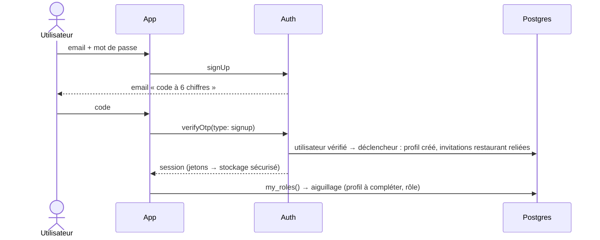
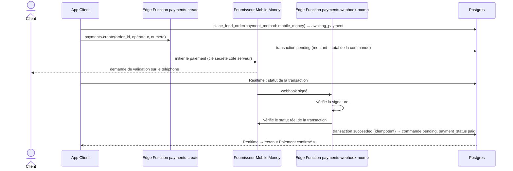
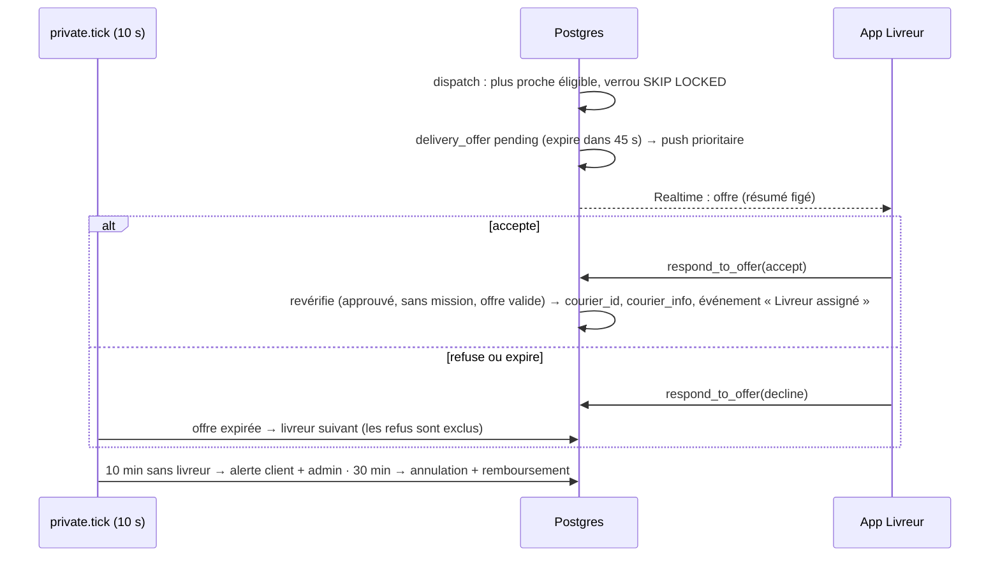

# Conception système — flux, état, cache, résilience

> Phase 3 (rôle : System Design). Complète `docs/architecture.md` et `docs/data-model.md`.

## 1. Repositories (package `core` sauf mention)

| Repository | Méthodes principales | Source |
|------------|----------------------|--------|
| `AuthRepository` | `signUpEmail`, `signUpPhone`, `verifyCode`, `resendCode`, `signIn`, `requestPasswordReset`, `resetPassword`, `signOut`, `authState` (flux) | Auth |
| `ProfileRepository` | `me`, `myRoles`, `update`, `deleteAccount` | REST, `my_roles`, `account-delete` |
| `AddressRepository` | `list`, `create`, `update`, `delete`, `setDefault` | REST (RLS) |
| `RestaurantRepository` | `listForZone(page)`, `detail`, `menu` | REST |
| `OrderRepository` | `quoteFood`, `placeFood`, `quoteParcel`, `placeParcel`, `cancel`, `list(page)`, `detail`, `events`, `watch(orderId)` (flux) | actions + Realtime |
| `TrackingRepository` | `watchCourierLocation(courierId)` (flux) | Realtime |
| `PaymentRepository` | `options(country)`, `start(orderId, method, operator, phone)`, `watchTransaction(orderId)`, `transactions(page)` | REST + `payments-create` + Realtime |
| `CourierRepository` (app Livreur) | `submitProfile`, `setOnline`, `reportLocation`, `watchOffers`, `respond`, `release`, `confirmDelivery`, `confirmCash`, `reportProblem`, `history(page)` | actions + Realtime |
| `RestaurantOpsRepository` (Back-office) | `watchOrders`, `transition`, `menu CRUD`, `hours`, `history` | REST + actions + Realtime |
| `AdminRepository` (Back-office) | zones, tarifs, paramètres, livreurs, utilisateurs, restaurants, supervision, attribution, transactions, stats | REST + actions `admin_*` |

Chaque méthode renvoie un modèle `freezed` ou lève une `Failure` typée :
`NetworkFailure` · `UnauthorizedFailure` · `BusinessFailure(code, details)` (codes stables de l'API, ex. `restaurant_closed`,
`price_changed`, `no_courier_available`, `invalid_transition`, `code_invalid`, `code_locked`) · `UnexpectedFailure`.
La traduction code → message français est centralisée (`core/l10n`).

## 2. Flux critiques

### 2.1 Inscription par email



### 2.2 Commande de repas payée en espèces

```mermaid
sequenceDiagram
  actor C as Client
  participant A as App Client
  participant DB as Postgres (actions + RLS)
  participant R as Back-office Restaurant
  C->>A: Valider
  A->>DB: quote_food_order (déjà affiché au panier)
  C->>A: Commander · 8 800 F
  A->>DB: place_food_order(…, expected_total, idempotency_key)
  DB->>DB: revérifie ouverture, disponibilité, prix, zone, livreurs en ligne ; fige les montants ; code de livraison ; transaction espèces « pending »
  DB-->>A: commande R-48K2Q (pending)
  DB-->>R: Realtime : nouvelle commande + push
  R->>DB: transition_order(accepted) puis (preparing)
  DB->>DB: preparing → private.dispatch()
```

### 2.3 Paiement Mobile Money (confirmation uniquement serveur)


Stripe suit le même schéma : `payments-create` crée un PaymentIntent et renvoie son secret client ; la feuille de
paiement native l'utilise ; seul le webhook `payment_intent.succeeded` vérifié change l'état.

### 2.4 Attribution d'un livreur



### 2.5 Suivi en direct et fraîcheur de la position

- Livreur en ligne : `report_location` toutes les ~60 s / 100 m ; en mission : ~10 s / 25 m (filtre de distance
  `geolocator`) ; envoi groupé si plusieurs positions en retard (on ne garde que la plus récente).
- Client : abonnement Realtime à `orders` (sa commande) et `courier_locations` (son livreur) tant que l'écran de suivi est
  ouvert ; à chaque reconnexion, relecture complète de la commande (les événements manqués ne sont jamais perdus).
- Affichage : `recorded_at` > 60 s → marqueur grisé « il y a N min », ETA « indisponible ». ETA = distance restante
  (vol d'oiseau × détour) / vitesse moyenne du moyen de transport (+ temps de préparation restant pour un repas).

### 2.6 Livraison et encaissement

```mermaid
sequenceDiagram
  actor D as Destinataire
  participant L as App Livreur
  participant DB as Postgres
  L->>DB: transition_order(picked_up) [colis espèces : confirm_cash_collected avant]
  L->>DB: transition_order(in_transit)
  D-->>L: code 4 chiffres
  L->>DB: confirm_delivery(order_id, code)
  alt code juste
    DB->>DB: delivered, delivered_at ; événement ; notification client
    L->>DB: confirm_cash_collected (repas en espèces)
    DB->>DB: transaction succeeded ; cash_ledger « collected » ; payment_status paid
  else code faux
    DB->>DB: failed_attempts + 1 ; à 5 → code verrouillé, alerte admin
  end
```

## 3. État et asynchrone (Riverpod)

- Chaque écran de données = un `AsyncNotifier` ; l'UI rend `loading` (squelette), `error` (message + Réessayer), `data`.
- Les flux Realtime sont exposés en `StreamProvider.autoDispose` : l'abonnement est fermé quand l'écran est quitté.
- Actions : le Notifier passe en état « envoi », bloque le double envoi, puis invalide les providers concernés.
- Actions optimistes limitées au local (panier, quantités) ; toute action serveur attend la confirmation (pas
  d'optimisme sur un statut de commande ou un paiement).

## 4. Cache et réseau intermittent

| Donnée | Stratégie |
|--------|-----------|
| Session, rôles, profil | Mémoire + stockage sécurisé (session) ; rafraîchis au démarrage |
| Accueil, restaurants de la zone, menus consultés | Cache local (`shared_preferences`, JSON compact, 24 h) affiché immédiatement, puis rafraîchi |
| Panier | Local uniquement, persistant ; revalidé par le devis serveur |
| Commandes, transactions | Page 1 en cache ; pages suivantes à la demande |
| Images | `cached_network_image` (disque), vignettes à la taille d'affichage |
| Actions (commander, accepter, confirmer…) | **Jamais** mises en file hors ligne : désactivées avec bandeau, reprises par l'utilisateur ; protégées par clé d'idempotence |

Pas de base locale ni de synchronisation complexe : les actions critiques exigent le serveur, ce qui garantit la cohérence.

## 5. Résilience

- Délais : 15 s par requête ; nouvelles tentatives automatiques (3, espacement croissant) **uniquement** pour les lectures.
- Mutations idempotentes : `idempotency_key` (commandes), clés uniques (transactions, offres), contrôles d'état
  dans chaque action (rejouer une action déjà faite renvoie l'état courant ou une erreur claire).
- Realtime : reconnexion automatique + resynchronisation complète à la reprise.
- Notifications : informatives seulement ; l'écran relit toujours l'état serveur (une notification perdue ne bloque rien).
- Webhooks : idempotents, vérifiés, rejouables ; un paiement confirmé en retard sur une commande déjà expirée est
  remboursé automatiquement (jamais perdu).
